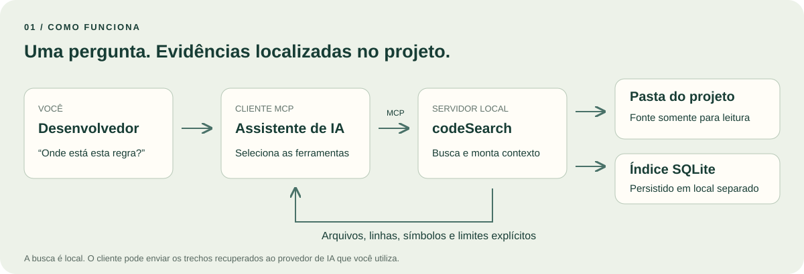
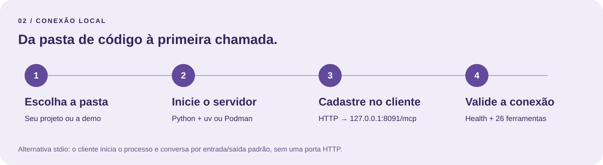
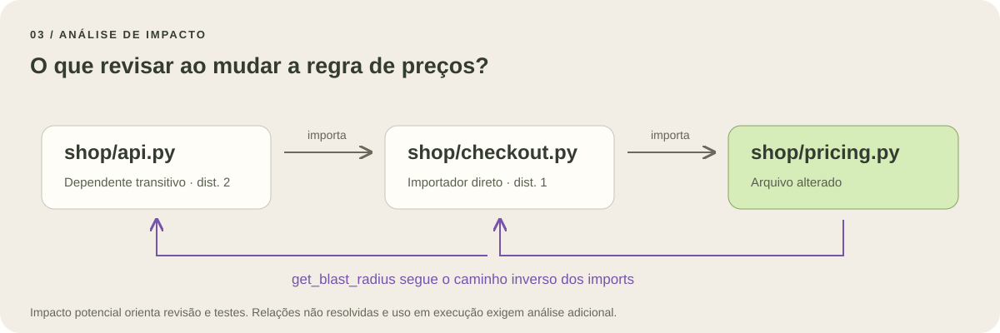

# codeSearch Local · Manual de uso

**Do primeiro acesso à análise de impacto.** Guia para desenvolvedores que usam um assistente de IA conectado ao MCP. Referência: codeSearch **0.2.1**, com **26 ferramentas**. Revisão editorial: **8 de novembro de 2026**.

Este manual explica como conectar o cliente, escolher uma ferramenta, interpretar a resposta e reproduzir as demos. Os exemplos usam uma pequena loja fictícia, incluída em [examples/manual-project](../examples/manual-project/README.md).

Abra a [versão navegável](MANUAL.html) para pesquisar ferramentas e percorrer as chamadas gravadas. O HTML funciona offline e incorpora suas imagens e respostas de demonstração; pode ser compartilhado como um único arquivo. Os comandos de instalação podem precisar de internet.

## 1. Para que serve

O codeSearch é um servidor **Model Context Protocol (MCP)**: ele oferece ferramentas para o assistente consultar uma pasta de código. Você faz uma pergunta no chat; o cliente chama as ferramentas; o servidor devolve arquivos, símbolos, trechos e relações para apoiar a resposta.



O servidor lê o código salvo em disco, incluindo alterações ainda não commitadas. Mantém um índice SQLite separado e consulta snapshots para alinhar fonte e localização dentro de cada chamada composta. Não precisa de uma API de IA, embeddings ou credenciais de GitHub/GitLab para indexar e buscar.

### Benefícios no dia a dia

| Situação | Como o MCP ajuda | Resultado útil para o desenvolvedor |
| --- | --- | --- |
| Cheguei a um projeto desconhecido | Resumo, árvore e outline mostram a organização | Um roteiro inicial de leitura com arquivos concretos |
| Sei o nome da função, mas não onde está | Busca de símbolos prioriza nomes exatos | Definição, caminho, linhas e ID para recuperar o código |
| Recebi uma mensagem de erro | Grep encontra o trecho e seu contexto | Um ponto de partida verificável para investigar |
| Vou alterar uma regra compartilhada | Importadores e impacto transitivo mostram candidatos | Uma lista inicial de módulos para revisar e testar |
| Preciso enviar contexto para a IA | Bundles agrupam definições e imports com limite de tamanho | Controle explícito sobre o volume de contexto recuperado |
| Acabei de salvar uma alteração | Atualização incremental reaproveita arquivos inalterados | Consultas sobre o estado local sem exigir commit ou push |

Esses recursos podem reduzir navegação manual e a quantidade de contexto irrelevante. O ganho varia com o projeto e o cliente; este manual não promete um percentual de economia de tokens ou de tempo. `max_chars` controla caracteres, não mede tokens.

**Quem faz o quê:** o MCP encontra e lê evidências; o assistente interpreta as respostas; o desenvolvedor revisa decisões e executa os testes adequados. As ferramentas do codeSearch não editam o código nem executam a aplicação indexada.

### Localidade e privacidade

A indexação e a busca ocorrem localmente. Se o seu cliente usa um modelo remoto, os trechos retornados podem ser enviados a esse provedor pelo cliente. O SQLite também contém cópias do código admitido. Portanto, “busca local” não significa que todo o fluxo do assistente permaneça offline.

## 2. Conectar em quatro passos



### Passo 1 — Escolha a pasta e o modo de execução

Você precisa de uma cópia do codeSearch, uma pasta de código para consultar e um cliente com suporte a MCP. Execute os comandos abaixo **na raiz do codeSearch**, onde estão `pyproject.toml` e `scripts/`.

Há dois caminhos: Python 3.11+ com `uv`, ou container com Podman. Substitua os caminhos de exemplo pelos seus. A pasta do servidor e a pasta do projeto consultado podem ser diferentes.

### Passo 2A — Inicie com Python e uv

Windows / PowerShell:

```powershell
uv sync --frozen
uv run codesearch --workspace "C:\projetos\minha-app" --transport http --port 8091
```

Linux / WSL:

```bash
uv sync --frozen
uv run codesearch --workspace /caminho/minha-app --transport http --port 8091
```

Mantenha esse terminal aberto. Use um segundo terminal para testar a conexão. Encerre o servidor com `Ctrl+C`. O host padrão é `127.0.0.1`. A CLI usa porta **8090** quando `--port` não é informado; este guia informa **8091** explicitamente para coincidir com os launchers.

### Passo 2B — Alternativa com Podman

No Windows, deixe a Podman machine iniciada quando estiver usando Podman nativo. O launcher também suporta Podman no WSL e usa `Ubuntu-24.04` como distribuição padrão nessa alternativa. Consulte a [instalação oficial do Podman](https://podman.io/docs/installation) para preparar o ambiente.

```powershell
.\scripts\run.ps1 -Workspace "C:\projetos\minha-app" -Name codesearch-local -Port 8091 -Build
```

Linux / WSL:

```bash
bash scripts/run.sh /caminho/minha-app http --build
```

O build inicial baixa a imagem base e as dependências. Depois, a consulta do servidor não depende de uma API externa. O container HTTP fica em segundo plano, monta a fonte somente para leitura e guarda o índice em um volume separado. A porta publicada é **8091**; a interna é **8090**.

Em execuções seguintes, omita `-Build` ou `--build` se a imagem não mudou. Para atualizar o código do servidor, reconstrua a imagem. O launcher PowerShell substitui uma instância codeSearch com o mesmo `-Name`, preservando o volume; isso interrompe temporariamente as conexões daquela instância. No Bash, pare a instância anterior antes de reutilizar seu nome.

### Passo 3 — Cadastre o servidor no cliente

O endereço MCP é **`http://127.0.0.1:8091/mcp`**. O endereço de saúde é **`http://127.0.0.1:8091/health`**. São endpoints diferentes: `/mcp` fala o protocolo e não é uma página para navegar.

**Codex — CLI ou configuração TOML.** Você pode cadastrar a conexão com:

```powershell
codex mcp add codesearch --url http://127.0.0.1:8091/mcp
```

Ou adicionar a entrada ao arquivo `~/.codex/config.toml` (no Windows, dentro da sua pasta de usuário):

```toml
[mcp_servers.codesearch]
url = "http://127.0.0.1:8091/mcp"
```

Mescle a entrada com a configuração existente, sem duplicar o nome. Reinicie ou reconecte a sessão do cliente para carregar a alteração. Referência: [MCP no Codex](https://learn.chatgpt.com/docs/extend/mcp?surface=cli).

**Cursor — JSON.** No projeto em que você usa o assistente, crie ou edite `.cursor/mcp.json`. O mesmo formato pode ser usado em `~/.cursor/mcp.json` para configuração global:

```json
{
  "mcpServers": {
    "codesearch": {
      "url": "http://127.0.0.1:8091/mcp"
    }
  }
}
```

Abra a área de MCP do cliente e confira se o servidor e suas ferramentas estão habilitados. Referência: [MCP no Cursor](https://prod.cursor.com/docs/mcp).

**VS Code — configuração MCP do cliente local.** Use `.vscode/mcp.json` no workspace do editor. A chave neste formato é `servers`:

```json
{
  "servers": {
    "codesearch": {
      "type": "http",
      "url": "http://127.0.0.1:8091/mcp"
    }
  }
}
```

Use os controles de MCP do VS Code para iniciar a conexão e habilite as ferramentas no chat do agente. Se o editor solicitar confiança no servidor, confira o endereço configurado antes de aceitar. Referência: [configuração MCP do VS Code](https://code.visualstudio.com/docs/agents/reference/mcp-configuration).

**Cliente executado em outra máquina:** `127.0.0.1` sempre aponta para a máquina ou ambiente onde o cliente roda. Um agente na nuvem, um container ou uma sessão remota pode não alcançar o servidor do seu computador por esse endereço. Este guia cobre conexão local; o servidor atual não configura autenticação e TLS para exposição pública.

### Passo 4 — Valide e faça a primeira pergunta

No PowerShell:

```powershell
Invoke-RestMethod http://127.0.0.1:8091/health
uv run python scripts/smoke.py http://127.0.0.1:8091/mcp
```

No Linux / WSL:

```bash
curl -fsS http://127.0.0.1:8091/health
uv run python scripts/smoke.py http://127.0.0.1:8091/mcp
```

O health deve retornar `status="ok"` e `service="codesearch-local"`. O smoke verifica uma conexão MCP real, as **26 ferramentas**, o resumo, o status, um recurso e um prompt. As contagens de arquivos e símbolos dependem da pasta escolhida.

Cole no chat do assistente:

> Use o MCP codeSearch para apresentar este projeto. Comece por get_project_summary, confira get_index_status e indique os arquivos por onde devo começar. Cite caminhos e linhas quando ler código. Informe qualquer limitação de cobertura.

Você deve ver o cliente chamar ferramentas do servidor. Alguns clientes acrescentam um prefixo ao nome, como `codesearch.search_symbols`; o nome original continua sendo `search_symbols`.

### Alternativa: conexão stdio sem porta HTTP

Em stdio, o próprio cliente inicia o processo e conversa por entrada e saída padrão. Com Python/uv, um exemplo para clientes que usam `mcpServers` é:

```json
{
  "mcpServers": {
    "codesearch": {
      "command": "uv",
      "args": [
        "--directory", "C:\\ferramentas\\codeSearch",
        "run", "codesearch",
        "--workspace", "C:\\projetos\\minha-app",
        "--transport", "stdio"
      ]
    }
  }
}
```

Execute `uv sync --frozen` na pasta do servidor antes da primeira conexão e garanta que o cliente encontre `uv` no PATH; se necessário, informe o caminho completo do executável. No Cursor, acrescente `"type": "stdio"` à entrada. Para o VS Code, use sua estrutura `servers` e `type="stdio"`. Para Codex/TOML, os campos são `command` e `args` dentro de `[mcp_servers.codesearch]`.

Para stdio em container, faça o build antes de conectar:

```powershell
podman build --format docker -t localhost/codesearch:latest -f Containerfile .
```

Depois adapte [examples/mcp-stdio-windows.json](../examples/mcp-stdio-windows.json), que inicia `scripts/run.ps1` com `-Transport stdio`. No Linux, o comando do cliente é `bash` e os argumentos incluem o caminho absoluto de `scripts/run.sh`, a pasta do projeto e `stdio`. Esse container não usa rede nem TTY. Não há `/health` em stdio; valide pela descoberta das ferramentas no cliente.

## 3. Seu primeiro fluxo de trabalho

Use a sequência **entender → localizar → ler → avaliar impacto**:

1. `get_project_summary`: veja o que foi indexado.
2. `search_symbols` ou `search_text`: encontre a região relevante.
3. `get_symbol_source` ou `get_context_bundle`: leia as definições selecionadas.
4. `find_importers` e `get_blast_radius`: levante dependências para revisão.
5. Confira cobertura, cortes e incertezas antes de concluir.

Você normalmente escreve a intenção em linguagem natural; o assistente monta o JSON. Os blocos do catálogo são **argumentos de chamada MCP**, não comandos de terminal nem mensagens para enviar com `curl`.

### Convenções que evitam erros

- Use `repo="local"` nas ferramentas que aceitam esse argumento. O servidor atende a pasta configurada ao iniciar.
- Use caminhos relativos àquela pasta, como `shop/pricing.py`, com `/`. Não passe caminhos absolutos nem `..` em `file_path`.
- Obtenha `symbol_id` em uma busca ou outline. Copie o valor retornado; não construa um ID por conta própria.
- Nos exemplos, `$calculate_total`, `$apply_discount` e `$Order` são marcadores didáticos. Substitua cada um pelo `symbol_id` correspondente. O roteiro automatizado faz essa substituição.
- IDs toleram inserções de linhas; renomear ou mover definições pode mudar a identidade. Nesse caso, busque novamente.
- `search_symbols` usa `kind="function"` por padrão. Use `kind=null` para incluir classes e outras categorias.

## 4. Demos guiadas

As respostas da versão HTML são **gravações de chamadas reais**, executadas pelo roteiro contra um servidor MCP via **stdio**. O reprodutor permite avançar, voltar e reproduzir automaticamente; não consulta um servidor ao clicar. Os diagramas são ilustrações técnicas, não capturas de interfaces de terceiros.

<!-- DEMO_PLAYER -->

### Preparar o projeto de exemplo

Na raiz do codeSearch, inicie uma instância exclusiva para a demo:

```powershell
uv run codesearch --workspace ./examples/manual-project --transport http --port 8092
```

Cadastre essa instância no seu cliente como `codesearch-demo`, usando `http://127.0.0.1:8092/mcp`. Nas perguntas abaixo, peça explicitamente para usar esse servidor. Os caminhos `shop/...` só existem quando a pasta indexada é a da demo.

### Demo A — Entender uma base desconhecida

**Pergunta para o chat:**

> Use codesearch-demo para explicar a loja de exemplo. Mostre a estrutura de shop, localize calculate_total e leia sua implementação. Cite arquivo e linhas, sem executar a aplicação.

**Chamadas:** `get_project_summary` → `get_file_tree` → `search_symbols(query="calculate_total", kind=null)` → `get_symbol_source` com o ID encontrado.

**O que observar:** a função está em `shop/pricing.py`, soma preços e delega o desconto a `apply_discount`. Você sai da estrutura geral para uma definição concreta sem copiar toda a pasta para o chat.

### Demo B — Investigar uma mensagem de erro

**Pergunta para o chat:**

> Use codesearch-demo para localizar a mensagem Invalid discount. Leia a condição que gera esse erro e proponha casos de teste, com base no código encontrado.

**Chamadas:** `grep_content(pattern="Invalid discount", context_lines=2)` → `get_file_outline(file_path="shop/pricing.py")` → `get_context_bundle` para os IDs de `apply_discount` e `calculate_total`.

**O que observar:** a validação aceita percentuais de 0 a 100; valores fora desse intervalo geram a exceção. Casos de teste propostos podem cobrir -1, 0, 100 e 101. O MCP fornece o trecho; a proposta dos testes é trabalho do assistente e precisa de revisão.

### Demo C — Planejar uma mudança de regra

**Pergunta para o chat:**

> Use codesearch-demo para avaliar uma mudança em shop/pricing.py. Liste os importadores diretos, os dependentes até três etapas e as chamadas de calculate_total. Separe evidências confirmadas pelo código de candidatos estáticos e sugira o que testar.



**Chamadas:** `find_importers` → `get_blast_radius(depth=3)` → `get_dependency_graph` → `get_call_hierarchy` com o ID de `calculate_total`.

**O que observar:** `shop/checkout.py` importa `shop/pricing.py` diretamente; `shop/api.py` depende dele transitivamente. Revise a regra de cálculo, o checkout e a integração da API. Um builtin como `sum` pode aparecer sem resolução local; isso é um limite informado, não uma dependência inventada.

### Demo D — Entender arquitetura e herança

**Pergunta para o chat:**

> Use codesearch-demo para encontrar ciclos de importação e subclasses declaradas de Order. Mostre a evidência e os limites da análise.

**Chamadas:** `get_dependency_cycles` → `search_symbols(query="Order", kind="class")` → `get_class_hierarchy(direction="subclasses")`.

**O que observar:** o ciclo intencional reúne `cycle_a.py` e `cycle_b.py`; `DiscountedOrder` declara `Order` como base. Não execute o exemplo circular: os arquivos existem para inspeção estática.

### Demo E — Atualizar depois de salvar

**Pergunta para o chat:**

> Depois da minha edição, use refresh_index e get_index_changes. Busque novamente o símbolo alterado e confirme o arquivo de origem. Explique que esse delta não é o histórico Git.

No roteiro automatizado, uma cópia temporária recebe a função `shipping_fee`; em seguida, o MCP atualiza o índice e encontra a nova função. **A edição é feita pelo roteiro, fora do MCP.** O projeto original da demo permanece igual.

### Reproduzir todas as chamadas e regenerar o manual

```powershell
uv run python scripts/demo_manual.py
uv run python scripts/build_manual.py
```

O primeiro comando chama as 26 ferramentas com um cliente FastMCP, descobre IDs, verifica resultados e grava [demo-results.json](manual/demo-results.json). Usa apenas uma cópia temporária do projeto fictício; não precisa de credenciais, modelo de IA ou servidor já iniciado. Inclui paginação, continuação por cursor, erro parcial de ID e atualização incremental. O segundo comando gera `docs/MANUAL.md` e `docs/MANUAL.html` a partir das fontes editoriais.

As demos não constituem benchmark de desempenho nem validação de todas as linguagens. O replay confirma o uso via stdio; para validar o HTTP da sua instalação, use `scripts/smoke.py`.

## 5. Como ler respostas e limites

| Campo ou sinal | Significado prático | Próximo passo |
| --- | --- | --- |
| `_meta.generation` ou `generation` | Versão do snapshot consultado | Evite juntar coordenadas antigas com fonte de outra geração |
| `coverage` / `_meta.coverage` | Alcance da extração e contagens | Confira arquivos só textuais, erros e exclusões |
| `truncated=true` | A resposta ou o índice foi limitado | Identifique qual limite foi atingido antes de concluir |
| `next_offset` | Há outra página | Repita a mesma consulta com esse valor em `offset` |
| `next_cursor` | A leitura de fonte pode continuar | Envie como `cursor` a get_file_content com o mesmo `file_path` |
| `source_truncated=true` | Parte de uma definição foi cortada | Continue pelo cursor ou solicite menos símbolos |
| `budget.used_chars` | Tamanho do JSON considerado pelo orçamento | Ajuste `max_chars` ou reduza a seleção |
| `omitted_count` / `omitted_imports` | Itens ou imports ficaram de fora | Divida a consulta ou amplie o orçamento |
| `timed_out=true` | A busca terminou por prazo de execução | Restrinja o caminho ou simplifique a regex |
| `unresolved`, `limitations` | Evidências que a análise não conseguiu resolver | Faça inspeção adicional; não invente relações |
| `depth_limited=true` | O limite de etapas impediu avançar no grafo | Aumente `depth` se essa expansão for necessária |
| `errors` / `error_count` | Erros parciais em lotes de símbolos | Corrija os IDs afetados e aproveite os resultados válidos |

Os campos variam por ferramenta. `coverage.complete=false` não equivale necessariamente a falha do servidor: um arquivo pode estar disponível para texto sem ter extração estrutural completa. Resultado vazio também não prova ausência de uso.

### Limites mais frequentes

- Indexação padrão: **1 MiB por arquivo**, **50.000 arquivos**, **128 MiB de texto**. Configuração na inicialização: `--max-file-bytes`, `--max-files`, `--max-total-bytes`.
- Paginação comum: `max_results` entre **1 e 500**, `offset` a partir de zero. Mantenha os filtros ao continuar.
- `get_file_content`: até **500 linhas** e **64.000 caracteres de fonte** por resposta. O cursor também continua no meio de uma linha.
- Fonte em lote, bundles, contexto de tarefa e grep: `max_chars` entre **1.024 e 128.000**, aplicado ao **JSON do resultado**, incluindo seus metadados. Não inclui o envelope de transporte MCP. Um orçamento pequeno demais para os metadados causa erro explícito.
- Grafo e hierarquias: profundidade de **0 a 20**. Outros limites de nós/arestas estão no catálogo.
- Grep: até **2.000 caracteres por linha** retornada, contexto limitado e prazo de execução para regex e busca.

Para paginar, por exemplo, chame `find_file` com `{"pattern":"**/*.py","max_results":2}`. Se vier `next_offset=2`, repita com os mesmos argumentos e `"offset":2`. Para fonte, copie o cursor retornado; ele é opaco e perde validade quando a geração muda.

### Linguagens e alcance da análise

Há extração de símbolos para Python, Java, JavaScript/JSX, TypeScript/TSX, Go, Rust, Bash, SQL, TOML, YAML, JSON e Markdown/MDX. A profundidade varia: suporte a símbolos não significa resolução completa de dependências, chamadas e herança naquela linguagem.

O grafo resolve módulos Python locais nas raízes `.` e `src`, e imports relativos JS/TS. Aliases de `tsconfig`, reexports/default exports, imports dinâmicos e bases ambíguas podem ficar sem resolução. Imports Bash dependem do ambiente de execução e podem ser registrados sem uma aresta resolvida. Chamadas e herança são candidatos estáticos; referências são textuais.

### Atualização e arquivos excluídos

O servidor verifica mudanças sob demanda, normalmente com intervalo de dois segundos; não há watcher de background. `refresh_index` faz a varredura imediatamente. `force=true` verifica hashes e refaz a extração de tudo que foi admitido.

As regras respeitam `.gitignore` e `.codesearchignore`, inclusive em subpastas. Também excluem metadados Git, `node_modules`, ambientes virtuais, caches, diretórios de build, binários, texto fora de UTF-8, symlinks/junctions e nomes sensíveis como `.env` e chaves privadas. `.env.example` é exceção ao bloqueio padrão de `.env`. Segredos escritos dentro de arquivos de código não são detectados apenas por essas regras de nomes.

## 6. Qual ferramenta escolher

| Quero… | Comece com | Continue com |
| --- | --- | --- |
| Me orientar no projeto | get_project_summary | get_repo_outline, get_file_tree |
| Encontrar um arquivo | find_file | get_file_outline, get_file_content |
| Encontrar uma função ou classe | search_symbols | get_symbol_source |
| Procurar palavras em arquivos | search_text | get_file_content |
| Procurar texto exato ou regex | grep_content | get_context_bundle |
| Reunir contexto de uma tarefa | assemble_task_context | get_context_bundle |
| Avaliar uma mudança de módulo | find_importers | get_blast_radius, get_dependency_graph |
| Inspecionar chamadas ou herança | search_symbols | get_call_hierarchy, get_class_hierarchy |
| Investigar índice incompleto | get_index_status | refresh_index, get_index_changes |

## 7. Catálogo das 26 ferramentas

Cada entrada traz uma intenção de chat, argumentos de exemplo, parâmetros, campos de resposta e limites. Os valores entre `$` e o nome de um símbolo são marcadores; o roteiro os resolve antes de executar.

### 01. get_project_summary

**Conhecer o projeto.** Obter uma visão inicial do workspace: linguagens, diretórios, arquivos, símbolos e prováveis pontos de entrada.

> Apresente este projeto e indique por onde começar a leitura.

```json
{
  "repo": "local"
}
```

**Parâmetros:** repo='local'.

**O que retorna:** files, symbols, languages, directories, entry_points e _meta.

**Atenção ao interpretar:** Pontos de entrada são sugestões por nome de arquivo. O resumo descreve apenas arquivos admitidos no índice.

### 02. get_repo_outline

**Conhecer o projeto.** Comparar o tamanho dos diretórios e localizar concentrações de código.

> Quais diretórios têm mais arquivos e símbolos?

```json
{
  "repo": "local",
  "max_results": 20
}
```

**Parâmetros:** repo='local', max_results=100, offset=0.

**O que retorna:** directories com path, files, symbols e languages; next_offset para continuar.

**Atenção ao interpretar:** As contagens são por diretório do arquivo. Não representam complexidade ou qualidade do código.

### 03. get_file_tree

**Conhecer o projeto.** Navegar pela árvore de arquivos indexados e restringir a exploração a uma área ou linguagem.

> Mostre os arquivos Python da pasta shop.

```json
{
  "repo": "local",
  "path_prefix": "shop",
  "language": "python",
  "max_results": 20
}
```

**Parâmetros:** path_prefix='', language=null, max_results=200, offset=0; repo='local'.

**O que retorna:** tree com nós de diretório e arquivo, linguagem e tamanho.

**Atenção ao interpretar:** Os filtros são aplicados antes da paginação. Cada página pode conter até 500 arquivos.

### 04. find_file

**Encontrar código.** Localizar arquivos por parte do nome ou padrão glob.

> Encontre o arquivo de cálculo de preços.

```json
{
  "repo": "local",
  "pattern": "**/pricing.py"
}
```

**Parâmetros:** pattern='', max_results=20, offset=0; repo='local'.

**O que retorna:** matches com path, language e size.

**Atenção ao interpretar:** Sem metacaracteres, a busca usa parte do nome do arquivo. Use glob para restringir pelo caminho; **/*.py inclui arquivos na raiz.

### 05. get_file_outline

**Conhecer o projeto.** Ler a estrutura de um arquivo sem solicitar todo o seu conteúdo.

> Liste as funções de pricing.py com suas linhas e IDs.

```json
{
  "repo": "local",
  "file_path": "shop/pricing.py"
}
```

**Parâmetros:** file_path relativo, max_results=100, offset=0; repo='local'.

**O que retorna:** symbols com name, qualified_name, kind, line, end_line, symbol_id e metadados disponíveis.

**Atenção ao interpretar:** Use symbol_id nas próximas consultas. A riqueza dos metadados depende da linguagem.

### 06. search_symbols

**Encontrar código.** Encontrar funções, classes e outras declarações pelo nome ou por termos relacionados.

> Localize calculate_total e guarde seu symbol_id.

```json
{
  "repo": "local",
  "query": "calculate_total",
  "kind": null,
  "detail_level": "compact"
}
```

**Parâmetros:** query='', kind='function', detail_level='standard', max_results=10, offset=0; filtros language, file_pattern e decorator; repo='local'. detail_level: compact, standard ou full.

**O que retorna:** results com localização, symbol_id e match_type; result_count é a quantidade da página.

**Atenção ao interpretar:** Nome exato vem antes do ranking BM25. kind=null inclui todas as categorias. Query vazia requer filtro de linguagem, arquivo ou decorator.

### 07. search_text

**Encontrar código.** Encontrar arquivos cujo conteúdo reúne palavras relevantes para uma investigação.

> Encontre arquivos que falem de discount e total.

```json
{
  "repo": "local",
  "query": "discount total",
  "language": "python",
  "max_results": 10
}
```

**Parâmetros:** query='', max_results=20, offset=0, language=null, file_pattern=null; repo='local'.

**O que retorna:** results com arquivos e trechos classificados pela busca lexical FTS5; result_count e paginação.

**Atenção ao interpretar:** Todas as palavras são exigidas (AND). Não é busca semântica, regex nem uma interface SQL. Para um trecho literal, use grep_content.

### 08. grep_content

**Encontrar código.** Buscar uma mensagem, trecho literal ou expressão regular, com linhas vizinhas e símbolo envolvente.

> Onde a mensagem Invalid discount aparece e em qual função?

```json
{
  "repo": "local",
  "pattern": "Invalid discount",
  "path_glob": "**/*.py",
  "context_lines": 2,
  "max_chars": 8000
}
```

**Parâmetros:** pattern obrigatório na prática; is_regex=false, case_sensitive=false, context_lines=0 (0..10), path_glob=null, max_results=20, offset=0, max_chars=32000; repo='local'.

**O que retorna:** matches, linhas/contexto, enclosing_symbol quando disponível, budget, truncated e timed_out.

**Atenção ao interpretar:** Para regex, use is_regex=true, por exemplo pattern='discount|subtotal'. Há timeout e corte por linha; uma resposta parcial não comprova ausência.

### 09. find_references

**Encontrar código.** Levantar ocorrências textuais de um identificador para orientar a leitura e uma possível renomeação.

> Liste as ocorrências de calculate_total no código Python.

```json
{
  "repo": "local",
  "name": "calculate_total",
  "path_glob": "**/*.py"
}
```

**Parâmetros:** name='', path_glob=null, max_results=20, offset=0; repo='local'.

**O que retorna:** references com arquivo, linha e contexto textual da ocorrência.

**Atenção ao interpretar:** Pode incluir declaração, imports e comentários. Não equivale a Find References de um compilador ou language server.

### 10. get_file_content

**Ler contexto.** Ler um intervalo de linhas de um arquivo admitido ou continuar uma leitura cortada.

> Mostre as primeiras 30 linhas de pricing.py.

```json
{
  "repo": "local",
  "file_path": "shop/pricing.py",
  "start_line": 1,
  "end_line": 30,
  "max_chars": 4000
}
```

**Parâmetros:** start_line=1, end_line=null, max_chars=64000 (1..64000), cursor=null, file_path relativo; repo='local'.

**O que retorna:** content, start_line, end_line, total_lines, truncated e next_cursor.

**Atenção ao interpretar:** Até 500 linhas por resposta. Passe next_cursor como cursor com o mesmo file_path para continuar, inclusive no meio de uma linha. Se a geração mudar, reinicie a leitura.

### 11. get_symbol_context

**Ler contexto.** Recuperar uma definição pelo nome, com linhas vizinhas; útil para clientes legados.

> Leia calculate_total no arquivo pricing.py, com duas linhas ao redor.

```json
{
  "repo": "local",
  "name": "calculate_total",
  "file_path": "shop/pricing.py",
  "context_lines": 2
}
```

**Parâmetros:** name obrigatório, file_path=null, line=null, context_lines=3 (0..50); repo='local'.

**O que retorna:** symbol e os campos de leitura de arquivo, incluindo content.

**Atenção ao interpretar:** Se o nome for ambíguo, informe file_path e line. Para novos fluxos, prefira get_symbol_source com symbol_id.

### 12. get_symbol_source

**Ler contexto.** Ler o código de um ou vários símbolos já identificados.

> Leia a implementação do símbolo calculate_total encontrado na busca.

```json
{
  "repo": "local",
  "symbol_ids": [
    "$calculate_total"
  ],
  "max_chars": 8000
}
```

**Parâmetros:** symbol_ids obrigatório (1..50), context_lines=0 (0..50), max_chars=64000; repo='local'.

**O que retorna:** results com source e localização; errors, error_count, budget e omitted_count.

**Atenção ao interpretar:** IDs duplicados são deduplicados preservando a ordem. Um ID inválido pode gerar erro parcial; confira errors mesmo quando a chamada termina com sucesso.

### 13. get_context_bundle

**Ler contexto.** Reunir definições e imports em uma resposta com tamanho controlado.

> Monte o contexto de calculate_total e apply_discount em até 12 mil caracteres.

```json
{
  "repo": "local",
  "symbol_ids": [
    "$calculate_total",
    "$apply_discount"
  ],
  "include_imports": true,
  "max_chars": 12000
}
```

**Parâmetros:** symbol_ids obrigatório (1..50), include_imports=true, max_chars=32000, compact=false; repo='local'.

**O que retorna:** results, imports, errors, budget, omitted_count, omitted_imports e omitted_import_files.

**Atenção ao interpretar:** compact=true traz metadados sem source. O limite considera o JSON completo do resultado, não tokens. Fonte parcial pode ser retomada com get_file_content.

### 14. assemble_task_context

**Ler contexto.** Selecionar símbolos por termos da tarefa e montar um pacote de contexto em uma chamada.

> Reúna contexto para investigar calculate_total e apply_discount.

```json
{
  "repo": "local",
  "task": "calculate_total apply_discount",
  "max_symbols": 4,
  "max_chars": 12000
}
```

**Parâmetros:** task obrigatório (1..2000 caracteres), max_symbols=8 (1..30), max_chars=32000; repo='local'.

**O que retorna:** query, basis='lexical_symbol_ranking' e campos do pacote de contexto.

**Atenção ao interpretar:** A seleção é lexical, sem inferência de IA. Inclua nomes e palavras usados no código; uma frase em português pode não encontrar identificadores em inglês.

### 15. get_file_imports

**Analisar impacto.** Examinar os imports declarados por um arquivo, incluindo aliases e evidências quando solicitado.

> Quais imports o checkout declara? Mostre os detalhes.

```json
{
  "repo": "local",
  "file_path": "shop/checkout.py",
  "detailed": true
}
```

**Parâmetros:** file_path relativo, detailed=false, max_results=100, offset=0; repo='local'.

**O que retorna:** imports com registros de origem; detailed=true acrescenta nomes originais/locais e evidências disponíveis.

**Atenção ao interpretar:** Um registro de import não garante uma dependência local resolvida. Consulte o grafo e unresolved para essa distinção.

### 16. find_importers

**Analisar impacto.** Encontrar arquivos que importam diretamente um arquivo local.

> Quem importa pricing.py diretamente?

```json
{
  "repo": "local",
  "file_path": "shop/pricing.py"
}
```

**Parâmetros:** file_path obrigatório, max_results=100, offset=0; repo='local'.

**O que retorna:** importers, evidências e diagnósticos de resolução.

**Atenção ao interpretar:** Na demo, checkout.py é um importador direto. api.py é dependente transitivo e aparece em get_blast_radius com profundidade suficiente.

### 17. get_dependency_graph

**Analisar impacto.** Explorar dependências locais entre arquivos em uma ou ambas as direções.

> Mostre a cadeia de dependências da API até duas etapas.

```json
{
  "repo": "local",
  "file_path": "shop/api.py",
  "direction": "imports",
  "depth": 2,
  "max_nodes": 30,
  "max_edges": 50
}
```

**Parâmetros:** file_path=null, direction='imports' (imports, importers, both), depth=1 (0..20), max_nodes=200 (1..1000), max_edges=500 (1..5000); repo='local'.

**O que retorna:** nodes, edges, total_files, total_edges, truncated, depth_limited e unresolved.

**Atenção ao interpretar:** Sem file_path, considera o grafo global sob limites de nós/arestas; depth não restringe essa visão. Arestas representam imports locais resolvidos estaticamente.

### 18. get_blast_radius

**Analisar impacto.** Levantar arquivos potencialmente afetados pela alteração de um módulo, seguindo importadores diretos e transitivos.

> Se eu mudar pricing.py, quais arquivos devo revisar e testar?

```json
{
  "repo": "local",
  "file_path": "shop/pricing.py",
  "depth": 3
}
```

**Parâmetros:** file_path obrigatório, depth=3 (0..20), max_results=100, offset=0; repo='local'.

**O que retorna:** affected_files com path e distance; depth_limited, truncated e evidências não resolvidas.

**Atenção ao interpretar:** Distância 1 indica importador direto. A lista orienta revisão e testes; não garante impacto em execução nem segurança para apagar código.

### 19. get_dependency_cycles

**Analisar impacto.** Encontrar grupos de dependências circulares no grafo de imports locais.

> Há ciclos de importação neste projeto?

```json
{
  "repo": "local",
  "max_results": 20
}
```

**Parâmetros:** max_results=50, offset=0; repo='local'.

**O que retorna:** cycles com files, file_count e files_truncated; paginação e diagnósticos.

**Atenção ao interpretar:** Retorna componentes fortemente conectados, incluindo autoimport explícito. Não enumera cada caminho circular possível.

### 20. get_call_hierarchy

**Analisar impacto.** Explorar candidatos de funções chamadas por um símbolo ou de seus chamadores.

> Quais chamadas calculate_total faz?

```json
{
  "repo": "local",
  "symbol_id": "$calculate_total",
  "direction": "callees",
  "depth": 1
}
```

**Parâmetros:** symbol_id obrigatório, direction='both' (callers, callees, both), depth=1 (0..20), max_nodes=100 (1..500); repo='local'.

**O que retorna:** nodes, edges, unresolved, semantics, limitations e metadata_missing_count.

**Atenção ao interpretar:** Candidatos sintáticos conservadores. Chamadas dinâmicas, bibliotecas externas e ambiguidades podem ficar sem resolução; não é um rastreamento de execução.

### 21. get_class_hierarchy

**Analisar impacto.** Explorar classes base e subclasses declaradas que possam ser resolvidas estaticamente.

> Quais subclasses declaradas de Order foram encontradas?

```json
{
  "repo": "local",
  "symbol_id": "$Order",
  "direction": "subclasses",
  "depth": 1
}
```

**Parâmetros:** symbol_id de classe obrigatório, direction='both' (bases, subclasses, both), depth=1 (0..20), max_nodes=100 (1..500); repo='local'.

**O que retorna:** nodes, edges, unresolved, semantics, limitations e metadata_missing_count.

**Atenção ao interpretar:** Procure classes com search_symbols(kind='class') ou kind=null. Bases dinâmicas e ambíguas podem permanecer sem resolução.

### 22. index_directory

**Manter o índice.** Indexar ou atualizar a pasta que já foi configurada ao iniciar o servidor.

> Atualize o índice desta pasta local.

```json
{
  "path": "."
}
```

**Parâmetros:** path='.'. Não recebe repo.

**O que retorna:** Relatório de varredura, geração e cobertura do índice.

**Atenção ao interpretar:** Não permite selecionar outra pasta do computador. Para trocar de projeto, inicie uma instância apontando para o novo workspace.

### 23. index_repo

**Manter o índice.** Manter compatibilidade com clientes que usam o nome index_repo para indexação local.

> Indexe o repositório local configurado.

```json
{
  "url": ".",
  "use_ai_summaries": false
}
```

**Parâmetros:** url='.', use_ai_summaries=false. Não recebe repo.

**O que retorna:** Mesmo tipo de relatório de refresh_index.

**Atenção ao interpretar:** Não clona URLs de GitHub/GitLab. use_ai_summaries é um parâmetro legado aceito e não ativa resumos de IA.

### 24. refresh_index

**Manter o índice.** Verificar alterações imediatamente, sem aguardar o intervalo de varredura sob demanda.

> Acabei de salvar uma alteração. Atualize o índice agora.

```json
{
  "force": false
}
```

**Parâmetros:** force=false. Não recebe repo. force=true verifica hashes e reprocessa todos os arquivos admitidos.

**O que retorna:** Relatório com geração, leituras, arquivos reprocessados, cobertura e diagnósticos.

**Atenção ao interpretar:** A atualização normal reaproveita conteúdo inalterado. Use force=true para uma verificação integral; não é necessário a cada consulta.

### 25. get_index_status

**Manter o índice.** Conferir a saúde, os limites e a cobertura do índice antes de confiar nos resultados.

> O índice está completo? Existem erros de parsing ou limites atingidos?

```json
{}
```

**Parâmetros:** Sem argumentos.

**O que retorna:** generation, coverage, diagnósticos, contadores, limits e scan_interval_seconds.

**Atenção ao interpretar:** complete=false pode refletir arquivos apenas textuais ou extração parcial. Leia os contadores e diagnósticos; não significa automaticamente indisponibilidade do servidor.

### 26. get_index_changes

**Manter o índice.** Consultar a última mudança significativa detectada nos arquivos indexados.

> Quais arquivos mudaram na última atualização significativa do índice?

```json
{}
```

**Parâmetros:** Sem argumentos.

**O que retorna:** Delta persistido de arquivos adicionados, alterados ou removidos e metadados disponíveis.

**Atenção ao interpretar:** Não é git diff, histórico de commits nem acompanhamento de todas as edições. Varreduras sem mudança preservam o último delta significativo.


## 8. Recursos e prompts adicionais

Além das ferramentas, o servidor expõe o recurso **`codesearch://summary`**, com o resumo do workspace, e o prompt **`explore_project`**, cujo argumento `question` orienta uma exploração do projeto. A forma de selecioná-los depende do cliente. O prompt sugere um fluxo; não executa a investigação sozinho.

## 9. Problemas comuns

| Sintoma | O que verificar / fazer |
| --- | --- |
| Conexão recusada | Confirme que o servidor está iniciado, a porta coincide e o cliente está no ambiente que alcança esse endereço |
| HTTP 501 ou serviço inesperado | Consulte `/health`; ele deve identificar codesearch-local. Outra aplicação pode estar usando a porta |
| Abrir `/mcp` no navegador dá erro | Use o health para uma checagem simples e um cliente MCP ou smoke para testar o protocolo |
| Nenhuma ferramenta aparece | Confira o formato do cliente, reconecte a sessão e habilite o servidor/ferramentas |
| O resumo mostra outro projeto | Confira `--workspace` ou `-Workspace` da instância associada àquela URL; repo não troca a pasta do servidor |
| Unknown workspace | Use repo="local" ou path="." / url="." nos aliases de indexação |
| Arquivo não encontrado ou excluído | Confira caminho relativo, regras de ignore, tamanho, encoding e get_index_status |
| Classe não aparece na busca | Informe kind="class" ou kind=null; o padrão é function |
| Busca por frase não acha a função | Use nomes do código em search_symbols; search_text exige todas as palavras; grep busca trecho literal |
| Symbol not found / ID ambíguo | Busque novamente e use symbol_id, evitando o ID legado file:line |
| Cursor antigo ou de outro arquivo | Reinicie a leitura para a geração atual e confira file_path |
| Budget too small | Aumente max_chars ou divida o lote; os metadados também consomem orçamento |
| Alteração salva ainda não aparece | Execute refresh_index e confira get_index_changes; force=true é a verificação integral |
| Processo encerra durante parsing após atualização | Confira a versão 0.2.1 e reconstrua a imagem; veja o diagnóstico MCP abaixo |

Para dois projetos simultâneos, use instâncias com nomes e portas diferentes, e entradas distintas no cliente. Cada pasta deve usar seu próprio banco/volume. Sem container, o padrão é `~/.cache/codesearch/<hash-da-pasta>`; `--data-dir` seleciona outro diretório. Não reutilize o mesmo banco entre projetos diferentes.

## 10. Referências e manutenção deste manual

As descrições das ferramentas foram conferidas em [server.py](../src/codesearch/server.py), [service.py](../src/codesearch/service.py), [relationships.py](../src/codesearch/relationships.py) e [retrieval.py](../src/codesearch/retrieval.py). As opções de inicialização vêm de [__main__.py](../src/codesearch/__main__.py) e dos launchers em `scripts/`.

Consulte também o [README](../README.md), as [notas de atualização](UPGRADE.md) e o [diagnóstico MCP](MCP-FIX.md). As configurações dos clientes foram conferidas na documentação oficial citada na seção de conexão, em 8 de novembro de 2026; interfaces e políticas podem variar por versão.

Para editar este material, altere [guia-base.md](manual/guia-base.md), [tools.json](manual/tools.json) ou os SVGs em `docs/manual/assets/`. Depois execute `scripts/demo_manual.py` e `scripts/build_manual.py`. A gravação registra sua própria data em UTC e a versão do servidor. O HTML não usa fontes externas, CDN ou serviços de analytics.
